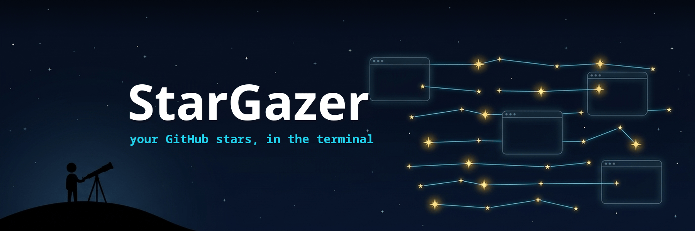
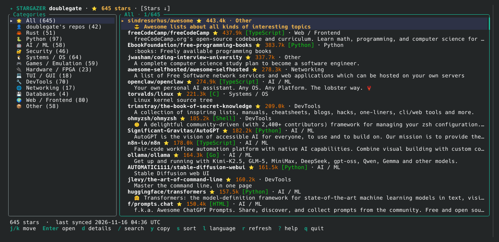
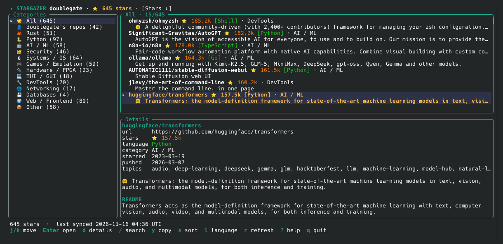
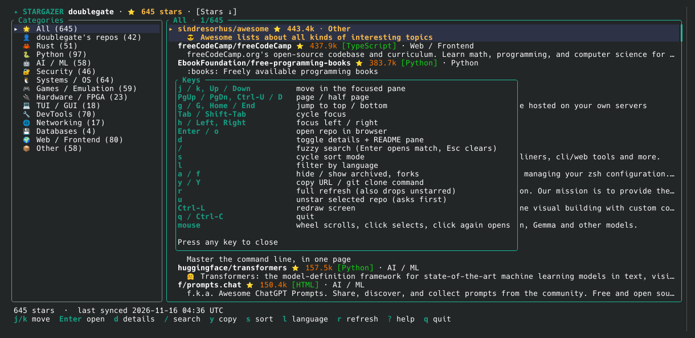
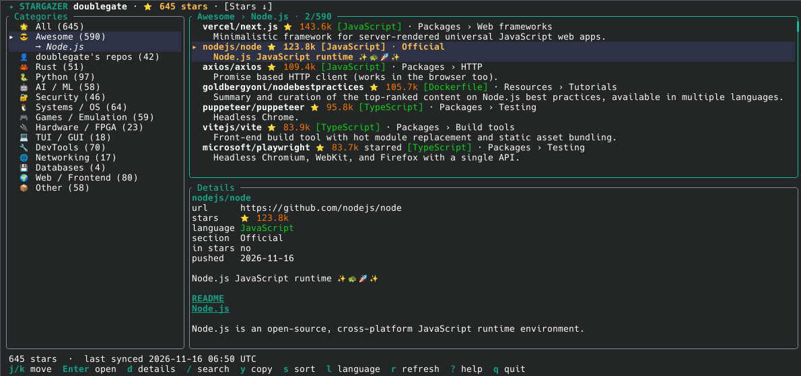
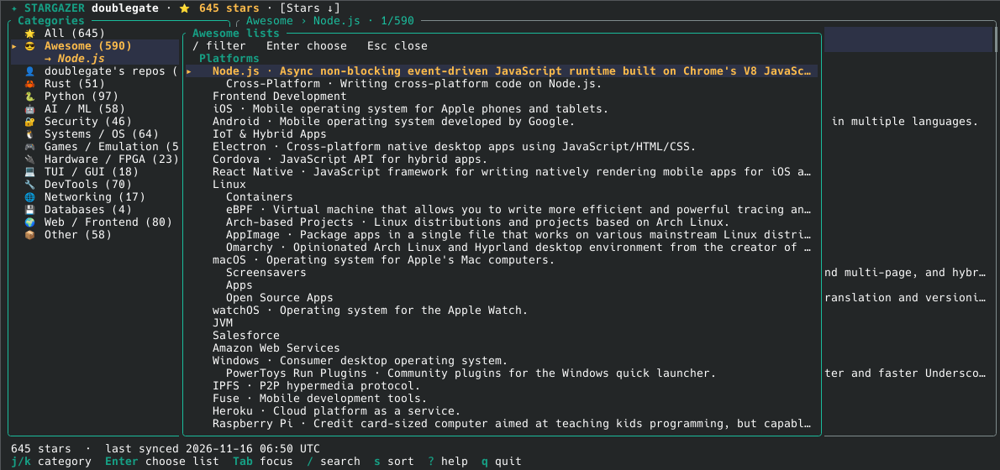

<p align="center">
  
</p>

# StarGazer

A fast, keyboard-driven TUI for browsing your GitHub starred repositories: organized,
searchable, and one keypress from your browser.


[](https://github.com/doublegate/StarGazer/actions/workflows/ci.yml)
[](https://github.com/doublegate/StarGazer/releases/latest)

---

## Features

- **Instant startup**: loads from a local cache and works offline; syncs new stars in the
  background while you browse
- **Smart categorization**: 13 categories assigned from GitHub topics, language, and
  whole-word description keywords
- **Your own repos**: starred repos you own get their own sidebar group (and stay in their
  category too)
- **Awesome lists**: browse any list from [sindresorhus/awesome](https://github.com/sindresorhus/awesome)
  with star counts, search, filters, sorting and README previews, just like your stars
- **Sort both panes**: `s` sorts whichever pane has focus; categories and repos sort
  independently
- **Relevance search**: `/` matches whole words (with prefixes and typo tolerance) in the
  repo name, owner, topics, language and description, best matches first
- **Filters**: by language (`l`), hide archived (`a`) or forks (`f`)
- **Details pane**: `d` shows metadata and a rendered README preview
- **Sort modes**: by stars, recently active, name, or when you starred it
- **Open, copy, unstar**: `Enter` opens in the browser, `y` copies the URL, `u` unstars
  (with confirmation)
- **Incremental sync**: after the first import only new stars are fetched; a periodic full
  sync also drops repos you have unstarred
- **Export**: `stargazer export` writes Markdown (awesome-list style), CSV or JSON
- **Mouse support**, themes, `NO_COLOR`, and a plain-ASCII mode
- **No config file needed**: works out of the box with your `gh` CLI login

## Screenshots



| Details pane with README preview (`d`) | Key reference (`?`) |
|---|---|
|  |  |

| An awesome list (awesome-nodejs) with details | The awesome list picker |
|---|---|
|  |  |

## Categories

| ASCII tag | Category | Detected via |
|-----------|----------|--------------|
| `rs` | Rust | topics, language |
| `py` | Python | topics, language |
| `ai` | AI / ML | topics, keywords |
| `sc` | Security | topics, keywords |
| `os` | Systems / OS | topics, language, keywords |
| `gm` | Games / Emulation | topics, keywords |
| `hw` | Hardware / FPGA | topics, language |
| `ui` | TUI / GUI | topics, keywords |
| `dt` | DevTools | topics, language, keywords |
| `nw` | Networking | topics, keywords |
| `db` | Databases | topics, language |
| `wb` | Web / Frontend | topics, language |
| `--` | Other | fallback |

In the default Unicode mode each category has an emoji icon instead of the tag. Every icon
is a single emoji-presentation code point, which every terminal draws two columns wide;
`--ascii` uses the tags above.

Keywords match whole words in the repository *name* and description (the owner is ignored),
so "rust" does not match "trust" and "cli" does not match "client". The highest score wins;
ties go to the category listed first.

## Installation

### Prerequisites

- [`gh` CLI](https://cli.github.com/) signed in (recommended): higher API rate limits, faster
  GraphQL sync, unstar support, and your login is detected automatically

### Prebuilt binaries

Download the archive for your platform from the
[latest release](https://github.com/doublegate/StarGazer/releases/latest) (Linux x86_64 and
aarch64, macOS Intel and Apple Silicon, Windows x86_64) together with `SHA256SUMS`, verify it,
and put `stargazer` on your `PATH`:

```bash
# Linux
sha256sum -c --ignore-missing SHA256SUMS
tar -xzf stargazer-v0.2.1-x86_64-unknown-linux-gnu.tar.gz
install -m 755 stargazer-v0.2.1-x86_64-unknown-linux-gnu/stargazer ~/.local/bin/

# macOS
grep aarch64-apple-darwin SHA256SUMS | shasum -a 256 -c
tar -xzf stargazer-v0.2.1-aarch64-apple-darwin.tar.gz
```

On Windows, compare `Get-FileHash stargazer-v0.2.1-x86_64-pc-windows-msvc.zip` with the line in
`SHA256SUMS`, then extract the zip.

> **macOS:** the binaries are not yet signed or notarized
> ([#3](https://github.com/doublegate/StarGazer/issues/3)), so Gatekeeper blocks a
> browser-downloaded copy with "cannot be verified". After checking the checksum, clear the
> quarantine flag with `xattr -d com.apple.quarantine stargazer`, or build from source
> (below). On Windows, SmartScreen may warn on first run; choose "More info", then
> "Run anyway".

### Build from source

Requires Rust 1.88 or newer ([rustup.rs](https://rustup.rs)). Either let Cargo build and
install it into `~/.cargo/bin`:

```bash
cargo install --locked --git https://github.com/doublegate/StarGazer --tag v0.2.1
```

or build a checkout and copy the binary wherever you keep tools:

```bash
git clone https://github.com/doublegate/StarGazer
cd StarGazer
cargo build --release --locked
install -m 755 target/release/stargazer ~/.local/bin/
```

### Upgrading from v0.1

Replace the binary the same way you installed it (v0.1 was usually copied to
`~/.local/bin`). Optionally keep the old one first:
`cp ~/.local/bin/stargazer ~/.local/share/stargazer/stargazer-v0.1.0.bin`.

- **The cache upgrades itself.** The first v0.2 launch converts
  `~/.local/share/stargazer/stars.json` in place and shows a one-time notice with how many
  repos changed category under the new rules. Nothing is lost, and v0.1 can still read the
  upgraded file, so going back only means restoring the old binary.
- **No built-in default user.** v0.1 fell back to a hard-coded account. v0.2 uses `--user`,
  `STARGAZER_USER`, the config file, the user your existing cache belongs to, or your `gh`
  login, in that order; with a v0.1 cache present, nothing needs to change.
- **Categories changed.** There is a new Python category and stricter keyword matching; see
  [CHANGELOG.md](CHANGELOG.md) for the full list.

## Usage

```bash
stargazer                       # your own stars (via gh login, or the cached user)
stargazer --user octocat        # someone else's stars
STARGAZER_USER=octocat stargazer
stargazer --refresh             # full resync now (also drops unstarred repos)
stargazer export -f md -o stars.md
stargazer paths                 # where the config and cache live
```

The GitHub user is resolved in this order: `--user`, `STARGAZER_USER`, `user` in the config
file, the user the existing cache belongs to, and finally the owner of your GitHub token.
Without any of these, StarGazer prints how to set one.

On first launch StarGazer imports all your stars, with progress in the status line.
Subsequent launches show the cache immediately and sync in the background.

### Options

| Flag | Meaning |
|------|---------|
| `-u, --user <LOGIN>` | GitHub user whose stars to browse |
| `--sort <stars\|recent\|name\|starred>` | Initial sort order |
| `--theme <dark\|light\|high-contrast\|mono>` | Color theme |
| `--ascii` | Plain-ASCII icons and glyphs (also `STARGAZER_ASCII=1`) |
| `--refresh` | Full resync at startup |
| `--no-mouse` | Do not capture the mouse (keeps terminal text selection) |
| `--config <PATH>` / `--cache <PATH>` | Override file locations |

### Export

```bash
stargazer export                         # Markdown to stdout, grouped by category
stargazer export -f csv -o stars.csv
stargazer export -f json --category Rust
stargazer export --sync                  # sync first
```

## Awesome lists

The **Awesome** row, pinned second in the sidebar, browses the lists indexed by
[sindresorhus/awesome](https://github.com/sindresorhus/awesome). With it selected, press
`Enter` (or click it) to open the list picker: sections, lists and sub-lists, in the index's
own order. Press `/` to filter the picker by name or description, then `Enter` to choose.

The chosen list appears under Awesome as `→ Node.js › Cross-Platform` (only while Awesome is
selected), and its entries fill the repo pane. They work like your stars: search, the language,
archived and fork filters, sorting, the details pane with README preview, `Enter` to open and
`y` to copy. Specifics:

- Each row shows the section of the list it came from (e.g. `Applications › Text editors`).
- The fourth sort mode reads **List order** here and keeps the list's own order.
- Entries that are not GitHub repositories (websites, docs) are included without a star count
  (`⭐ -`) or README; `Enter` opens their link.
- Repos already in your stars are marked `starred`; `u` unstars those, and only those.

The index is synced at startup and on every full refresh, like your stars. A list is fetched the
first time you open it and then cached, so reopening it is instant; it is fetched again after
`stale_days`, or when you press `r` with it chosen. The last chosen list is restored at startup.

**Star counts need a token** (see below) and are the slow part: GitHub allows roughly 2,000
repository lookups a minute, and a big list such as awesome-rust (about 1,800 repositories)
takes around 15-20 seconds and most of that minute. Repos you have starred cost no lookup.
If you open another big list straight away, some rows may show `⭐ -` at first; that is
expected, not a bug: the counts that were fetched are kept, and the rest fill in when you
reopen the list a minute later.

## Keybindings

| Key | Action |
|-----|--------|
| `↑` / `k`, `↓` / `j` | Move in the focused pane (wraps at the ends) |
| `←` / `h`, `→` | Focus sidebar / repo list / details |
| `Tab` / `Shift+Tab` | Cycle focus |
| `PgUp` / `PgDn`, `Ctrl+U` / `Ctrl+D` | Page / half page through the repo list (README when details are focused) |
| `g` / `Home`, `G` / `End` | Jump to the top / bottom of the repo list |
| `Enter` / `o` | Open selected repo in browser |
| `Enter` on Awesome | Choose an awesome list (`/` filters the picker) |
| `/` | Search (`Enter` opens the selected match, `Esc` clears) |
| `Esc` | Clear search, or close the details pane |
| `d` | Toggle details + README pane |
| `s` | Cycle the sort of the focused pane (sidebar or repo list) |
| `l` | Filter by language |
| `a` / `f` | Hide or show archived repos / forks |
| `y` / `Y` | Copy URL / `git clone` command |
| `r` | Full refresh (also drops unstarred repos) |
| `u` | Unstar the selected repo (asks first; needs a token, own stars only) |
| `?` | Help |
| `Ctrl+L` | Redraw the screen |
| `q` / `Ctrl+C` | Quit |

Mouse: the wheel scrolls the pane under the pointer; clicking selects, clicking the selected
repo again opens it.

## Sort modes

`s` cycles the sort of the focused pane. The repo list:

1. **Stars ↓**: most-starred first (default)
2. **Recently Active**: by last push date
3. **Name A→Z**: alphabetical by `owner/repo`
4. **Starred ↓**: by when you starred it, newest first (**List order** in an awesome list)

The Categories pane (focus it with `←`) sorts independently of the repo list:

1. **Default order**: the fixed order of the table above (default)
2. **Stars ↓**: categories holding the most repos first
3. **Recently Active**: the category with the most recently pushed repo first
4. **Name A→Z**
5. **Starred ↓**: the category you starred something in most recently first

All, Awesome and your own repos always stay at the top, in that order. The pane title shows
the category sort unless it is the default.

## Search

Press `/` and type. Each word you type is matched against the individual words of every
repo, and every word must match somewhere. Results are ranked by relevance (the pane title
shows "by relevance"); with an empty search the list is in the sort order above.

- **Where it matched**, strongest first: repo name, owner, topics and language, description.
- **How well it matched**, strongest first: the exact word, the start of a word
  (`rata` finds "ratatui"), inside a longer word (4+ letters), a typo (one edit for 5+
  letters, two for 8+: `emulater` finds "emulator"), and letters in order within one word
  (`rtui` finds "ratatui").
- Repos whose name matches come first, then those matching topics or the description, and
  weak typo or abbreviation matches last. Equally relevant repos keep the current sort
  order, and a multi-word query that appears as a phrase (`command line`) ranks higher.

## Configuration

Optional. Run `stargazer paths` to see the location (`~/.config/stargazer/config.toml` on
Linux). Every key is optional:

```toml
user = "octocat"
sort = "stars"          # repo list: stars | recent | name | starred
category_sort = "default" # categories pane: default | stars | recent | name | starred
ascii = false
theme = "dark"          # dark | light | high-contrast | mono
stale_days = 7          # full resync after N days (drops unstarred repos); 0 = never
mouse = true

[colors]                # any ratatui color name or #rrggbb
accent = "cyan"
selected_bg = "#303040"
```

Precedence: command-line flags, then environment variables (`STARGAZER_USER`,
`STARGAZER_ASCII`, `NO_COLOR`), then this file, then defaults.

## Cache

Stars are cached at `~/.local/share/stargazer/stars.json` on Linux (`stargazer paths` shows
the location elsewhere). Writes are atomic and the file is private (mode 0600). A corrupt
cache is moved aside to `stars.json.bad` and rebuilt. Delete the file to force a full
re-import. Caches from v0.1 are read and upgraded automatically.

Awesome data lives next to it, in `awesome/`: the parsed index (`index.json`), one file per
opened list (`lists/<owner>__<repo>.json`), and the last chosen list (`state.json`). Deleting
the directory is safe; it is rebuilt on the next sync and as lists are opened.

## GitHub API authentication

StarGazer uses your `gh` CLI token (`gh auth token`) if available, then the `GITHUB_TOKEN`
or `GH_TOKEN` environment variables.

- **With a token** stars are fetched through the GraphQL API (100 per request, topics and
  star dates included) and the limit is 5,000 requests per hour.
- **Without a token** the REST API is used (60 requests per hour). Unchanged star lists cost
  a conditional request that does not count against the limit. README previews also use
  this budget.
- **Awesome lists** load anonymously, but their star counts come from GraphQL and need a token;
  without one, entries show `⭐ -`. Unchanged lists and the index are revalidated with
  conditional requests.

## Dependencies

| Crate | Purpose |
|-------|---------|
| [ratatui](https://github.com/ratatui/ratatui) / [crossterm](https://github.com/crossterm-rs/crossterm) | TUI framework and terminal backend |
| [tokio](https://tokio.rs) / [futures](https://github.com/rust-lang/futures-rs) | Async runtime and event stream |
| [reqwest](https://github.com/seanmonstar/reqwest) | GitHub API HTTP client (rustls) |
| [unicode-width](https://github.com/unicode-rs/unicode-width) / [unicode-segmentation](https://github.com/unicode-rs/unicode-segmentation) | Display-width-correct text |
| [clap](https://github.com/clap-rs/clap) | Command line |
| [serde](https://serde.rs) / [serde_json](https://github.com/serde-rs/json) / [toml](https://github.com/toml-rs/toml) / [csv](https://github.com/BurntSushi/rust-csv) | Serialization, config, export |
| [open](https://github.com/Byron/open-rs) / [arboard](https://github.com/1Password/arboard) | Browser launching, clipboard |
| [directories](https://github.com/dirs-dev/directories-rs) | XDG / platform directories |
| [chrono](https://github.com/chronotope/chrono) | Date/time handling |
| [pulldown-cmark](https://github.com/pulldown-cmark/pulldown-cmark) | Parsing the awesome index and lists |
| [anyhow](https://github.com/dtolnay/anyhow) / [thiserror](https://github.com/dtolnay/thiserror) | Error handling |
| [winresource](https://github.com/BenjaminRi/winresource) (Windows builds only) | Embeds the icon and version info in `stargazer.exe` |

## Contributing

See [CONTRIBUTING.md](CONTRIBUTING.md). Changes are listed in [CHANGELOG.md](CHANGELOG.md).

## License

MIT, see [LICENSE](LICENSE)
